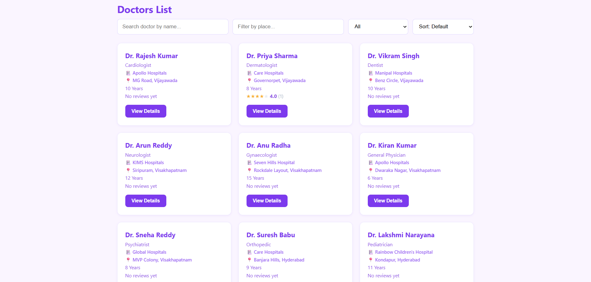
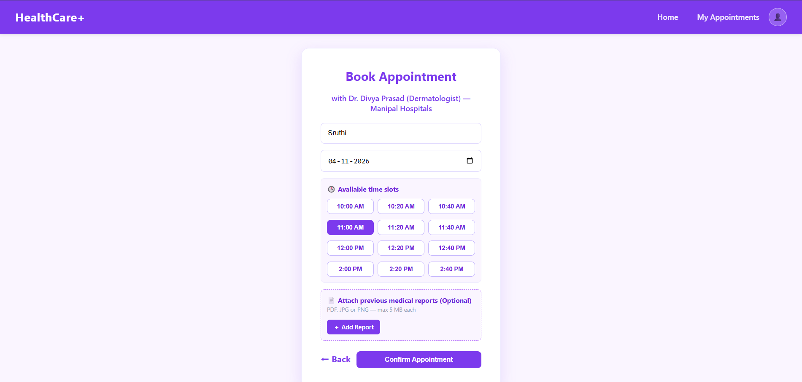
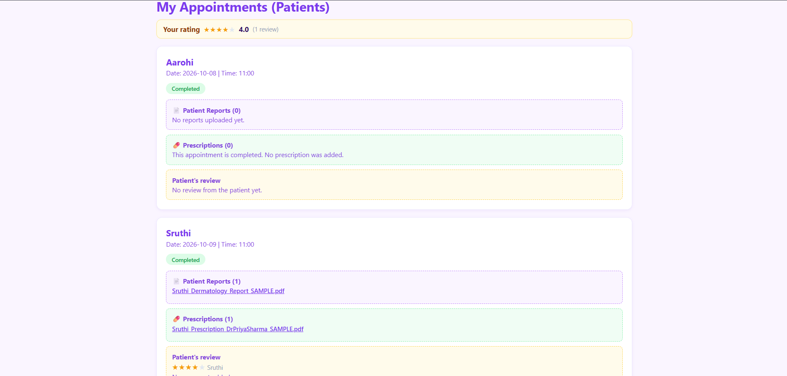
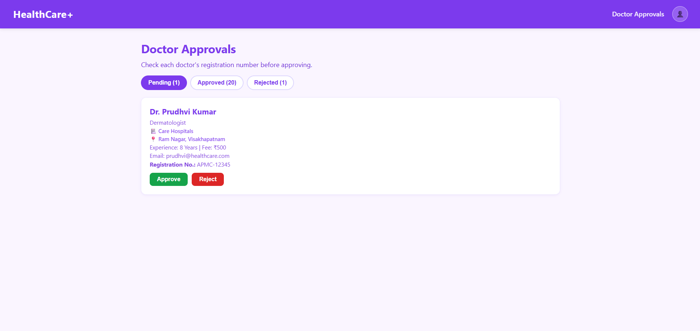

# HealthCare+ — Healthcare Appointment System

A full-stack (MERN) web application where patients find verified doctors, book appointment slots, share medical reports, and receive prescriptions, while doctors manage their schedule and an admin verifies doctor registrations.

> **Note:** All sample doctors, reports and prescriptions in this repository are fictional and created for demo/testing only. Do not upload real medical data.

<!-- Built by Yasasri Mudunuri -->

---

## Table of contents

1. [Features](#features)
2. [Tech stack](#tech-stack)
3. [Project structure](#project-structure)
4. [Getting started](#getting-started)
5. [Demo accounts](#demo-accounts)
6. [How the main flows work](#how-the-main-flows-work)
7. [Business rules](#business-rules)
8. [API overview](#api-overview)
9. [Security](#security)
10. [Known limitations](#known-limitations)
11. [Future scope](#future-scope)
12. [Screenshots](#screenshots)

---

## Features

**Patients**
- Register / log in, view and edit profile
- Search doctors by name, place (address) and specialization; sort by rating
- View doctor details: hospital, address, fee, working days and timings, ratings and reviews
- Book from the doctor's **available time slots** (booked and past slots are not selectable)
- Get a **token number** per doctor per day
- Attach previous medical reports while booking, or add them later to upcoming appointments
- View appointment history, cancel upcoming appointments
- View prescriptions added by the doctor
- Rate and review a doctor after the appointment is completed

**Doctors**
- Register with a Medical Council registration number (account stays *pending* until approved)
- Set working days, hours, slot length and an optional break
- See booked appointments with patient reports
- Upload a prescription, then mark the appointment as completed
- See their average rating and individual patient reviews

**Admin**
- Review pending doctor registrations (registration number, hospital, details)
- Approve, reject (with reason) or later revoke a doctor

---

## Tech stack

| Layer | Technology |
|---|---|
| Frontend | React (Vite), React Router, Axios, plain CSS |
| Backend | Node.js, Express |
| Database | MongoDB with Mongoose |
| Auth | JWT, bcryptjs |
| File uploads | Multer (local disk storage) |

---

## Project structure

```
Healthcare appointment system/
├── Backend/
│   ├── middleware/     authMiddleware, adminMiddleware, upload
│   ├── models/         User, Appointment, Review
│   ├── routes/         auth, doctors, appointments, reviews, admin, files
│   ├── utils/          slots.js (slot generation and availability rules)
│   ├── uploads/        uploaded reports and prescriptions (created automatically)
│   ├── seedDoctorUsers.js
│   ├── createAdmin.js
│   ├── approveExistingDoctors.js
│   └── server.js
└── Frontend/
    └── src/
        ├── api/         axios instance (adds the JWT to every request)
        ├── components/  Navbar, ProtectedRoute, AdminRoute, DoctorCard, StarRating, FileLink
        └── pages/       Welcome, Login, Register, Home, Doctors, DoctorDetails,
                         BookAppointment, Success, AppointmentHistory, Profile,
                         Availability, AdminDashboard
```

---

## Getting started

### Prerequisites
- Node.js (LTS)
- MongoDB running locally (default `mongodb://127.0.0.1:27017`)

### 1. Backend

```bash
cd Backend
npm install
```

Create `Backend/.env`:

```
PORT=5000
MONGO_URI=mongodb://127.0.0.1:27017/healthcareDB
JWT_SECRET=replace-with-a-long-random-string
```

Start the server:

```bash
npm run dev
```

You should see `Server running on http://localhost:5000` and `MongoDB Connected Successfully`.

### 2. Seed sample data (optional but recommended)

```bash
# 19 sample approved doctors across 7 cities (password: doctor123)
node seedDoctorUsers.js

# Create the admin account (there is no admin sign-up in the UI)
node createAdmin.js admin@example.com YourStrongPassword "Admin"
```

`approveExistingDoctors.js` is only needed if you are upgrading an older database that already has doctors without a verification status.

### 3. Frontend

```bash
cd Frontend
npm install
npm run dev
```

Open the URL Vite prints (usually `http://localhost:5173`). The API base URL is set in `Frontend/src/api/axios.js` (`http://localhost:5000/api`).

---

## Demo accounts

| Role | How to get it |
|---|---|
| Patient | Register from the Welcome page ("Sign In" button → "I am a Patient") |
| Doctor (seeded) | e.g. `priya@healthcare.com` / `doctor123` |
| Doctor (new) | Register as a doctor, then wait for admin approval |
| Admin | Create with `node createAdmin.js <email> <password> "<name>"` |

Change or remove the seeded passwords before sharing the app publicly.

---

## How the main flows work

**Doctor onboarding**
1. A doctor registers with a registration number → status `pending`.
2. The doctor cannot log in and is hidden from the doctors list.
3. The admin approves or rejects (with a reason). Approved doctors can log in and appear in search.

**Booking**
1. Patient opens a doctor, picks a date, and sees that day's slots.
2. The server re-checks everything on submit (doctor approved, date in range, slot on the doctor's grid, slot free, time not in the past) and assigns a token number.

**Consultation**
1. On or after the appointment date the doctor uploads a prescription, then marks the appointment completed.
2. The patient sees the prescription and can leave a rating and review.

---

## Business rules

- Booking window: from today up to **30 days** ahead; past dates and passed times are rejected.
- Default availability (until a doctor saves their own): **Mon–Sat, 10:00–17:00, 30-minute slots, break 13:00–14:00**.
- A slot can hold one **Upcoming** appointment; cancelling frees it.
- Token numbers run per doctor per date; cancelled tokens are not reused.
- Reports can be added only to **upcoming** appointments.
- One prescription per appointment; it must be added before the appointment is marked completed, and not before the appointment date.
- One review per appointment, only after the doctor marks it **Completed**.

---

## API overview

All routes are under `/api`. "Auth" means a valid JWT is required.

| Area | Endpoint | Access |
|---|---|---|
| Auth | `POST /auth/register`, `POST /auth/login`, `PUT /auth/profile` | public / public / auth |
| Doctors | `GET /doctors`, `GET /doctors/:id`, `GET /doctors/:id/slots?date=YYYY-MM-DD` | public |
| Doctors | `GET/PUT /doctors/me/availability` | doctor |
| Appointments | `POST /appointments`, `GET /appointments/my`, `PUT /appointments/:id/cancel`, `POST /appointments/:id/reports` | patient |
| Appointments | `GET /appointments/doctor/my`, `POST /appointments/:id/prescriptions`, `PUT /appointments/:id/complete` | doctor |
| Reviews | `POST /reviews`, `GET /reviews/my` | patient |
| Reviews | `GET /reviews/received` | doctor |
| Reviews | `GET /reviews/doctor/:id` | public |
| Admin | `GET /admin/doctors`, `PUT /admin/doctors/:id/approve`, `PUT /admin/doctors/:id/reject` | admin |
| Files | `GET /files/:filename` | the appointment's patient or doctor only |

---

## Security

- Passwords hashed with bcrypt; sessions use signed JWTs.
- Role checks are enforced **on the server** (the UI hiding a page is not relied upon).
- The `role` accepted at registration is restricted to patient/doctor; admins can only be created with the script.
- Doctors need admin approval before they can log in or be booked.
- Medical files are **not publicly served**. They are downloaded through `GET /api/files/:filename`, which checks that the requester is the patient or doctor of that appointment.
- Uploads are limited to PDF/JPG/PNG, 5 MB, with random server-generated file names and an extension taken from the validated file type.
- Booking details such as doctor name and hospital are read from the database, not trusted from the client.

---

## Known limitations

These are deliberate scope limits for a demo/learning project.

- **Doctor verification is manual.** The registration number is self-reported; the admin must check it against the medical council register. It is not verified automatically.
- Two requests arriving in the same instant could both pass the slot check. A unique database index would close this.
- Date/time rules use the **server's local time zone**; set the zone explicitly before deploying.
- The JWT is stored in `localStorage`; an httpOnly cookie is safer for production.
- Files are stored unencrypted on local disk, and there is no audit log of who opened a file.
- Upload validation checks the declared file type and size, not the file's actual content.
- No HTTPS, rate limiting, forgot-password flow, email/SMS reminders or automated tests yet.
- Reviews cannot be edited, deleted or moderated, and a doctor can mark an appointment completed before its date.
- Availability is a weekly pattern only; one-off leave days are not supported.

---

## Future scope

- Per-date leave and holidays for doctors
- Email/SMS appointment reminders and a forgot-password flow
- Cloud file storage with expiring signed URLs
- Review edit/reply and admin moderation
- Phone or call-centre booking for patients who cannot use the website
- Automated tests and CI

---

## Screenshots




